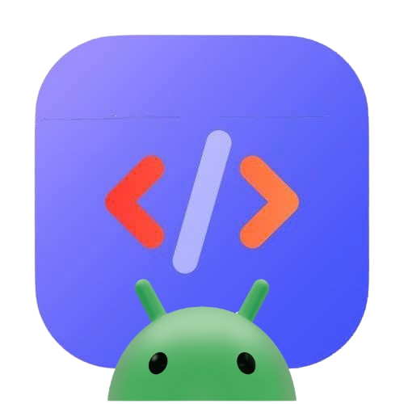

<p align="center">
  
</p>

<h1 align="center">PiperOS Tool for Android</h1>

<p align="center">
  Bộ công cụ Android gồm quản lý ứng dụng và tệp, APK Editor, trình duyệt, media, 2FA, điều khiển thiết bị và nhiều tiện ích khác.
</p>

<p align="center">
  <a href="https://github.com/Phi574/PiperOSTool-Android/actions/workflows/android-ci.yml"></a>
  <a href="LICENSE"></a>
  
</p>

## Tải ứng dụng

**Bản mới nhất: 3.7.5.PRE** · Android 10 trở lên · nhắm Android 17 (API 37).

[**Tải APK từ GitHub Releases**](https://github.com/Phi574/PiperOSTool-Android/releases/tag/v3.7.5.PRE) · [Xem lịch sử phát hành](CHANGELOG.md)

Có thể cập nhật trong ứng dụng. Mặc định, PiperOS chỉ đề xuất bản ổn định và cập nhật lần lượt. Chương trình Beta/Preview có thể bật trong Cập nhật; bản thử nghiệm cần chấp nhận điều khoản. Màn Cập nhật kiểm tra chữ ký trước khi cài, nên APK phải dùng cùng khóa ký với ứng dụng hiện có.

## Tính năng

- **Ứng dụng:** xem ứng dụng đã cài, thông tin gói, quyền, chứng chỉ và một số dấu hiệu thư viện trong APK; bật/tắt, chạy, sao lưu và mở APK bằng trình chỉnh sửa.
- **PiperOS ADB:** kết nối ADB không dây, cấp quyền cho thao tác ứng dụng và tệp; một số chức năng phụ thuộc phiên bản Android và ROM.
- **Quản lý tệp và APK Editor:** duyệt, sao chép, nén/giải nén tệp; xem cấu trúc và chỉnh sửa bản APK xuất ra.
- **PiperOS Browser:** duyệt web theo tab, tải tệp, khôi phục phiên và quản lý dữ liệu trình duyệt.
- **PiperOS Media và 2FA:** phát nhạc/video; tạo mã TOTP, HOTP và Steam Guard, thêm tài khoản thủ công hoặc bằng QR.
- **View Remote và tiện ích:** chia sẻ màn hình trong mạng nội bộ, Fake Map GPS, QR và Terminal.

Một số tính năng cần quyền đặc biệt hoặc dịch vụ đi kèm và có thể hoạt động khác nhau tùy thiết bị/ROM. Hãy chỉ cấp quyền khi cần dùng tính năng đó.

## Build từ mã nguồn

Yêu cầu Android Studio/JDK 17 trở lên, Android SDK 37 và kết nối mạng để tải thư viện Gradle.

```powershell
.\gradlew.bat assembleDebug testDebugUnitTest
```

APK thử nghiệm được tạo tại `app/build/outputs/apk/debug/app-debug.apk`.

Cấu hình Firebase không được lưu trong repository. Để build các phần cần Firebase, đặt tệp `google-services.json` của dự án Firebase riêng tại `app/google-services.json`. Không commit tệp cấu hình riêng tư hoặc service-account key.

## Dự án liên quan

- [PiperOSTool-PC](https://github.com/Phi574/PiperOSTool-PC) — ứng dụng companion cho Windows.
- [Piperos_termux](https://github.com/Phi574/Piperos_termux) — runtime và kho package Termux của PiperOS.

## Quyền riêng tư và bảo mật

- [Chính sách quyền riêng tư](PRIVACY.md)
- [Báo cáo lỗ hổng](SECURITY.md)
- [Thành phần bên thứ ba và giấy phép](THIRD_PARTY_NOTICES.md)

## Đóng góp

Đọc [hướng dẫn đóng góp](CONTRIBUTING.md), mở issue nếu cần trao đổi và chạy build/test trước khi gửi pull request.

## Giấy phép

Mã nguồn PiperOS Tool được cấp phép theo **GNU GPL-3.0-only**. Xem [LICENSE](LICENSE), [COPYRIGHT](COPYRIGHT) và danh sách giấy phép bên thứ ba trong [THIRD_PARTY_NOTICES.md](THIRD_PARTY_NOTICES.md).
