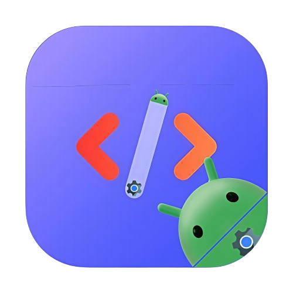

<p align="center">
  
</p>

<h1 align="center">PiperOS Tool for Android</h1>

<p align="center">
  Bộ công cụ Android kết hợp quản lý ứng dụng và tệp, trình duyệt, media,
  xác thực, tiện ích hệ thống, điều khiển từ xa và terminal Linux.
</p>

<p align="center">
  <a href="https://github.com/Phi574/PiperOSTool-Android/actions/workflows/android-ci.yml"></a>
  <a href="LICENSE"></a>
  
  
</p>

> PiperOS Tool đang được phát triển. Một số thao tác cần ADB, quyền Trợ năng, quyền vị trí hoặc dịch vụ Android tương ứng. Khả năng hoạt động có thể khác nhau theo thiết bị và ROM.

## Mục lục

1. [Tải ứng dụng và cập nhật](#tải-ứng-dụng-và-cập-nhật)
2. [Bản đồ ứng dụng và các thành phần](#bản-đồ-ứng-dụng-và-các-thành-phần)
3. [Tính năng theo từng trang](#tính-năng-theo-từng-trang)
4. [Cấu hình giao diện bằng JSON](#cấu-hình-giao-diện-bằng-json)
5. [Các repository liên kết](#các-repository-liên-kết)
6. [Quyền, bảo mật và giới hạn](#quyền-bảo-mật-và-giới-hạn)
7. [Build và cấu hình Firebase](#build-và-cấu-hình-firebase)
8. [Đóng góp và giấy phép](#đóng-góp-và-giấy-phép)

## Tải ứng dụng và cập nhật

Bản đang phát hành: **3.9.0.BETA**, versionCode **108**, yêu cầu Android 10 trở lên.

- [Tải PiperOS Tool 3.9.0.BETA](https://github.com/Phi574/PiperOSTool-Android/releases/tag/v3.9.0.BETA)
- [Xem tất cả bản phát hành](https://github.com/Phi574/PiperOSTool-Android/releases)
- [Đọc lịch sử thay đổi](CHANGELOG.md)

Đây là bản Beta, có thể còn lỗi. Trong app, kênh Stable được dùng mặc định. Người dùng có thể bật chương trình Beta hoặc Preview trong phần cập nhật sau khi đọc và chấp nhận điều khoản tương ứng.

Trình cập nhật kiểm tra package, phiên bản và chữ ký của APK trước khi cài. APK cập nhật đè cần cùng chứng chỉ ký với ứng dụng hiện tại. Mặc định app đề xuất phiên bản theo thứ tự để giảm rủi ro khi bỏ qua một bản chuyển tiếp.

## Bản đồ ứng dụng và các thành phần

PiperOS Tool Android là ứng dụng trung tâm. Các trang Home, Beta, Apps, Files, Settings và Info dẫn tới các nhóm công cụ bên dưới. Một số thành phần có repository riêng; sơ đồ phân biệt rõ mã Android, JSON điều khiển giao diện, ứng dụng PC và Linux runtime.

```mermaid
flowchart TB
    APK["PiperOS Tool APK<br/>Android 10+"]

    subgraph APP["Các công cụ trong ứng dụng Android"]
        HOME["Home"]
        BROWSER["PiperOS Browser"]
        MEDIA["PiperOS Media"]
        TWOFA["PiperOS 2FA"]
        QR["PiperOS QR"]
        GPS["Fake Map GPS"]
        TRANSFER["PiperOS Data Transfer"]
        APPS["Ứng dụng và APK Editor"]
        FILES["PiperOS File Manager"]
        ADB["PiperOS ADB"]
        SETEDIT["PiperOS SetEdit"]
        INFO["Info và bảo mật tài khoản"]
        TERMINAL["PiperOS Terminal UI / Service"]
    end

    APK --> HOME
    HOME --> BROWSER
    HOME --> MEDIA
    HOME --> TWOFA
    HOME --> QR
    HOME --> GPS
    HOME --> TRANSFER
    APK --> APPS
    APK --> FILES
    APPS -. thao tác cần quyền .-> ADB
    FILES -. truy cập chuyên sâu .-> ADB
    SETEDIT -. đọc/ghi Settings .-> ADB
    APK --> SETEDIT
    APK --> INFO

    subgraph JSON["JSON cấu hình trên repo Android chính · nhánh master"]
        AUTH["config/auth.json"]
        SCREENS["config/auth/*.json"]
        WINDOW["config/window.json"]
    end
    APK -. tải cấu hình .-> AUTH
    AUTH --> SCREENS
    SCREENS -. dựng các màn .-> AUTHUI["Welcome · Login · Signup<br/>Lock · Forgot password · Phone auth"]
    APK -. tải menu .-> WINDOW
    WINDOW -. điều khiển mục menu .-> HOME
    WINDOW -. điều khiển mục bảo mật .-> INFO

    subgraph REMOTE["Chiếu màn hình và thiết bị Windows"]
        VIEW["PiperOS View Remote<br/>Android"]
        PAIR["LAN · QR · mã 6 số"]
        PC["PiperOS Tool PC<br/>Windows companion"]
        AIRPLAY["AirPlay / RAOP<br/>iPhone · iPad · macOS"]
        USB["USB ADB / Type-C"]
    end
    APK --> VIEW
    VIEW --> PAIR
    PAIR <--> PC
    AIRPLAY --> PC
    USB <--> PC

    subgraph LINUX["Terminal Linux runtime · repository Piperos_termux"]
        RUNTIME["PiperOS Termux Runtime"]
        ABIS["aarch64 · arm · x86_64"]
        APT["Kho package APT PiperOS"]
    end
    TERMINAL --> RUNTIME
    RUNTIME --> ABIS
    RUNTIME --> APT
```



### Các trang trong ứng dụng

| Trang | Nội dung chính |
| --- | --- |
| **Home** | Browser, Media, 2FA, QR, Fake Map GPS và Data Transfer; nút Window mở thông tin cá nhân, bảo mật và Có gì mới. |
| **Beta** | Khu vực các công cụ và tính năng đang thử nghiệm. |
| **Apps** | Danh sách ứng dụng, thông tin package, quyền, chứng chỉ và thao tác được Android/ADB cho phép. |
| **Files** | Quản lý tệp, archive, APK và truy cập chuyên sâu qua ADB khi người dùng bật quyền. |
| **Settings** | Giao diện, ngôn ngữ, cập nhật và các tùy chọn của app. |
| **Info** | Phiên bản, thiết bị, trạng thái dịch vụ và liên kết các thành phần PiperOS. |

## Tính năng theo từng trang

### Home: công cụ dùng hằng ngày

- **PiperOS Browser:** nhiều tab, tab ẩn danh, khôi phục phiên, lịch sử theo ngày, User-Agent tùy chỉnh, tải tệp và phát video. Thanh điều hướng có thể thu gọn khi cuộn; trình chuyển tab, báo cáo quyền riêng tư và các tùy chọn trình duyệt nằm trong app.
- **Công cụ nhà phát triển trong Browser:** xem DOM/HTML của tab hiện tại, resource/network đã tải, thông tin trang và chạy JavaScript. Có thể áp dụng thay đổi HTML để kiểm thử nhanh; thay đổi đó mất khi tải lại trang.
- **Kho tài khoản Browser:** nhận diện biểu mẫu đăng nhập và chỉ lưu khi người dùng đồng ý. Tên đăng nhập, mật khẩu và metadata website được mã hóa cục bộ trước khi đồng bộ Firestore theo Firebase UID. PIN mở kho không được gửi nguyên bản lên Firebase; profile WebView tách riêng theo UID.
- **PiperOS Media:** quét nhạc và video trên thiết bị; lọc nguồn, tìm kiếm, sắp xếp, hàng đợi riêng, phát nền, Picture-in-Picture và điều khiển media.
- **PiperOS 2FA:** lưu nhiều tài khoản xác thực; tạo TOTP tự đổi theo chu kỳ hoặc theo yêu cầu, HOTP theo bộ đếm và mã Steam Guard. Có thể thêm bằng khóa thiết lập hoặc QR, nhập/xuất JSON và QR tương thích Google Authenticator. Khi đăng nhập PiperOS, dữ liệu 2FA có thể đồng bộ Firebase theo tài khoản.
- **PiperOS QR:** tạo và quét mã QR bằng giao diện của app.
- **PiperOS Fake Map GPS:** mô phỏng vị trí cố định hoặc hành trình có tốc độ, phương tiện, dừng/đỗ và lặp tuyến. Hỗ trợ nhiều waypoint và marker chuyển động; vị trí được phát qua các provider Android và Google Fused Location.
- **PiperOS Data Transfer:** gửi tệp, ảnh, video, tài liệu và APK qua mạng cục bộ; ghép thiết bị bằng tìm LAN, QR hoặc mã 6 số, có thể tạo điểm phát Wi-Fi. Phiên truyền được mã hóa, có tiến trình theo từng mục, màn xem trước và vùng chờ trước khi nhập dữ liệu nhận. Việc cài APK vẫn cần xác nhận Android. Chưa chuyển dữ liệu riêng của app khác, SMS/lịch sử gọi, danh bạ/lịch tự động, mật khẩu Wi-Fi đã lưu hoặc kết nối trực tiếp USB-C giữa hai điện thoại.

### Apps và Files: quản lý ứng dụng, APK, tệp

- **Trang Apps:** duyệt ứng dụng đã cài và ứng dụng hệ thống; xem trạng thái, phiên bản, package, quyền, Activity và chứng chỉ. App có thể phân tích một số dấu hiệu trong APK như Google Ads, xác minh giấy phép, mua InApp hoặc bản vá tùy chỉnh. Các thao tác bật/tắt, chạy, sao lưu APK và quản lý quyền phụ thuộc Android, ADB và ROM.
- **PiperOS APK Editor:** mở APK đã cài hoặc tệp APK, duyệt archive, trích xuất theo nhóm hoặc toàn bộ, chỉnh tệp văn bản, xem báo cáo manifest và build APK mới. Có thể chọn nhiều tệp hoặc thư mục để backup. Tác vụ backup lớn dùng tối đa bốn luồng và foreground service; viewer hỗ trợ ảnh, video, GIF, âm thanh, PDF và văn bản.
- **PiperOS File Manager:** thumbnail ảnh/video/APK và app data, gallery vuốt ngang, biểu tượng thư mục theo loại. Hỗ trợ nén/giải nén ZIP, 7Z, TAR, GZIP, BZIP2, XZ, LZ4 và ZSTD; ZIP hỗ trợ mật khẩu AES-256. Tác vụ archive chạy bằng foreground service, WakeLock và notification tiến độ.
- **PiperOS ADB:** khi người dùng chủ động kết nối Wireless debugging, app khởi chạy tiến trình Java bằng `app_process` với UID shell. Client giao tiếp qua Binder/AIDL và RPC; shell hỗ trợ stdin/stdout, exit code, thư mục làm việc, biến môi trường và timeout. Các nhóm quyền có thể thu hồi; quyền nhạy cảm mặc định tắt và thao tác được ghi log. ADB không tự khởi động lại sau reboot; hỗ trợ còn tùy ROM/OEM.
- **PiperOS SetEdit:** xem System, Secure và Global Settings cùng Android Properties, Java Properties và Linux Environment. Có tìm kiếm, thêm/sửa/xóa các bảng được phép, lưu thay đổi, tạo nhiều bản sao lưu và hoàn tác theo khác biệt. Properties được hiển thị theo quyền đọc hiện có; sửa đổi bảng hệ thống cần ADB và có thể ảnh hưởng thiết bị.

> APK do APK Editor build được ký bằng khóa **PiperOS Editor test key**, khác khóa phát hành PiperOS Tool. APK đầu ra này không thể cập nhật đè lên ứng dụng gốc nếu chữ ký khác.

### View Remote và ứng dụng PC

**PiperOS View Remote** truyền màn hình Android trong mạng LAN bằng tìm thiết bị, QR hoặc mã sáu số. Ba pipeline gồm JPEG tương thích, H.264 phần cứng và HEVC phần cứng; hai bên thương lượng codec và có thể hạ cấp khi thiết bị không hỗ trợ. Người xem chọn chất lượng/FPS; điều khiển chạm cần quyền Trợ năng trên thiết bị phát.

[PiperOS Tool PC](https://github.com/Phi574/PiperOSTool-PC) là ứng dụng Windows companion: nhận luồng View Remote, hỗ trợ USB ADB/Type-C và nhận AirPlay/RAOP từ iPhone, iPad hoặc macOS qua Wi-Fi. Receiver AirPlay quảng bá tên PiperOS. Tỷ lệ ảnh dọc/ngang được giữ khi đổi hướng; số FPS, băng thông và độ trễ trên PC phản ánh frame thực đã nhận/render, không chỉ là cấu hình người dùng chọn.

### Tài khoản, giao diện và thông báo

- Luồng tài khoản gồm Welcome, đăng nhập, đăng ký, khóa bảo mật, quên mật khẩu và xác thực điện thoại. Firebase xử lý xác thực; app có thể giữ phiên đã đăng nhập khi offline theo cache và chính sách hiện hành.
- Menu Window có Thông tin cá nhân, Mật khẩu bảo mật và Có gì mới. Menu bảo mật gồm lịch sử thiết bị đăng nhập, đổi mật khẩu và quản lý liên kết đăng nhập.
- Giao diện **Modern** tối giản là mặc định; **Classic** giữ giao diện cũ và có bề mặt Liquid Glass. Người dùng chọn sáng, tối hoặc theo hệ thống, cùng tiếng Việt hoặc tiếng Anh. Classic có backdrop động, hiệu ứng refraction/dispersion và pipeline AGSL trên Android 13+; Android 10–12 dùng fallback native.
- Firebase Cloud Messaging nhận thông báo đẩy khi app chạy nền; Firebase In-App Messaging hiển thị chiến dịch bên trong app. Firebase Performance Monitoring ghi nhận các chỉ số hiệu năng được SDK hỗ trợ.
- Android 16 trở lên có thể hiển thị Live Update cho tiến trình khi hệ thống cho phép; máy cũ dùng notification tiêu chuẩn.

### PiperOS Terminal và runtime Linux

PiperOS Terminal cung cấp shell Android và nhiều phiên Linux, lịch sử lệnh, foreground service và bàn phím terminal riêng. App tải catalog runtime từ GitHub để cài/nâng cấp/hạ cấp theo chế độ giữ dữ liệu hoặc cài sạch.

Runtime Linux được build và quản lý riêng trong [Piperos_termux](https://github.com/Phi574/Piperos_termux). Repo này tạo bootstrap và package cho `aarch64`, `arm`, `x86_64`, đồng thời phát hành kho APT PiperOS đã ký. Runtime đầy đủ không được đóng sẵn trong APK Android; app xác minh manifest và khóa ký repo trước khi bật kho. Package Termux chính thức không được trộn vào `$PREFIX` của PiperOS.

## Cấu hình giao diện bằng JSON

Một số bề mặt của app lấy nội dung từ JSON trên nhánh `master` của repository Android chính. JSON không chứa Kotlin tùy ý và không thay thế toàn bộ Activity/XML; Android vẫn chịu trách nhiệm xử lý xác thực, quyền và hành động được phép.

| Tệp cấu hình | Điều khiển phần nào | Hành vi khi offline |
| --- | --- | --- |
| [`config/auth.json`](https://github.com/Phi574/PiperOSTool-Android/blob/master/config/auth.json) | Bật/tắt và liệt kê Welcome, Login, Signup, Lock, Forgot password, Phone auth. | Auth dùng cache/JSON đóng gói theo chính sách; người đã đăng nhập có thể tiếp tục phiên cached, khách chưa đăng nhập cần mạng. |
| [`config/auth/`](https://github.com/Phi574/PiperOSTool-Android/tree/master/config/auth) | JSON bố cục/nội dung riêng của từng màn xác thực. | Dùng cache gần nhất hoặc bản JSON đóng gói trong APK. |
| [`config/window.json`](https://github.com/Phi574/PiperOSTool-Android/blob/master/config/window.json) | Các mục Window và menu bảo mật: trạng thái bật, tiêu đề, mô tả, icon và action đã định nghĩa trong app. | Menu lấy cấu hình trực tuyến; khi không tải được, các mục phụ thuộc JSON báo không khả dụng. Hỗ trợ vẫn mở offline. |

Xem toàn bộ [thư mục config trên repo chính](https://github.com/Phi574/PiperOSTool-Android/tree/master/config). Ứng dụng chỉ gọi những action có sẵn trong code; JSON không thể chạy mã tùy ý trên thiết bị.

## Các repository liên kết

| Nhóm trong sơ đồ | Repository / đường dẫn | Vai trò |
| --- | --- | --- |
| **Ứng dụng Android** | [PiperOSTool-Android](https://github.com/Phi574/PiperOSTool-Android) | APK, giao diện, Browser, Media, ADB, quản lý ứng dụng/tệp, View Remote và Terminal UI/service. |
| **JSON giao diện** | [config trên nhánh `master`](https://github.com/Phi574/PiperOSTool-Android/tree/master/config) | Cấu hình auth và Window của chính app Android; không phải repository riêng. |
| **Windows companion** | [PiperOSTool-PC](https://github.com/Phi574/PiperOSTool-PC) | Receiver PiperOS View Remote, AirPlay/RAOP và kết nối ADB/USB trên Windows. |
| **Linux runtime** | [Piperos_termux](https://github.com/Phi574/Piperos_termux) | Bootstrap Linux, build package, runtime manifest và kho APT PiperOS cho ba ABI. |

## Quyền, bảo mật và giới hạn

PiperOS chỉ nên yêu cầu quyền khi người dùng mở tính năng cần quyền đó. Tùy công cụ, Android có thể hỏi quyền media, thông báo, vị trí, usage access, quản lý tệp hoặc quyền Trợ năng. Tính năng chuyên sâu cần ADB; app không tự nhận quyền ROOT. Đọc thêm [PRIVACY.md](PRIVACY.md) về dữ liệu và [SECURITY.md](SECURITY.md) để báo cáo lỗ hổng.

Dữ liệu cục bộ nhạy cảm như phiên, cài đặt, lịch sử, terminal, media, mock GPS và workspace APK được tách theo Firebase UID; các vùng hỗ trợ mã hóa dùng AES-256-GCM với khóa Android Keystore riêng. Hành vi và quyền truy cập còn phụ thuộc loại dữ liệu và tính năng cụ thể.

Một số thao tác có thể bị chặn bởi Android hoặc ROM, kể cả khi đã bật ADB. PiperOS ADB không tự chạy lại sau khởi động lại. Data Transfer không thể sao chép dữ liệu riêng của app khác hoặc các dữ liệu cần vai trò hệ thống mà app không được cấp.

## Build và cấu hình Firebase

### Yêu cầu

- Android Studio với JDK 17 trở lên.
- Android SDK 37.
- Kết nối mạng để Gradle tải dependency.

### Build và kiểm tra dự án

```powershell
.\gradlew.bat assembleDebug lintDebug testDebugUnitTest
```

APK debug nằm tại `app/build/outputs/apk/debug/app-debug.apk`.

### Firebase

`app/google-services.json` không được lưu trong Git. Để bật đăng nhập và đồng bộ Firebase, tạo hoặc chọn Firebase project của bạn, tải cấu hình Android và đặt tại `app/google-services.json`. Gradle chỉ bật Google Services khi tệp tồn tại; vì vậy fork không có cấu hình riêng vẫn build được nhưng phần Firebase sẽ tắt.

Không commit `google-services.json`, service-account JSON hoặc Firebase Admin credentials. Rules mẫu cho Realtime Database và Cloud Firestore nằm trong [`database.rules.json`](database.rules.json) và [`firestore.rules`](firestore.rules). Sau khi kiểm tra đúng Firebase project, có thể triển khai rules bằng:

```powershell
firebase deploy --only database,firestore:rules
```

Firestore Rules giới hạn dữ liệu tài khoản theo UID đang xác thực; các đường dẫn không khớp tiếp tục bị từ chối mặc định.

## Đóng góp và giấy phép

Đọc [CONTRIBUTING.md](CONTRIBUTING.md), mở issue bằng mẫu có sẵn và chạy build/lint trước khi gửi pull request.

PiperOS Tool được phát hành theo **GNU GPL version 3 only**. Xem [LICENSE](LICENSE), [COPYRIGHT](COPYRIGHT) và [THIRD_PARTY_NOTICES.md](THIRD_PARTY_NOTICES.md).
