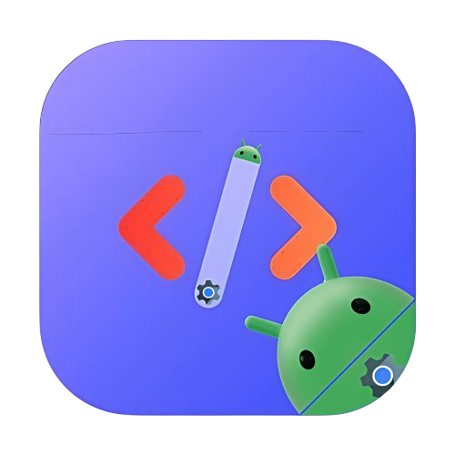
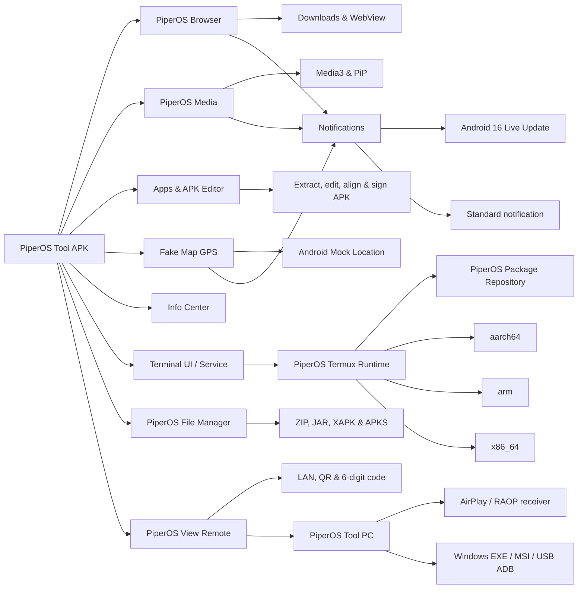

<p align="center">
  
</p>

<h1 align="center">PiperOS Tool for Android</h1>

<p align="center">
  Bộ công cụ Android tích hợp quản lý ứng dụng và tệp, APK Editor, trình duyệt, media, điều khiển thiết bị, xác thực 2FA và các tiện ích hệ thống.
</p>

<p align="center">
  <a href="https://github.com/Phi574/PiperOSTool-Android/actions/workflows/android-ci.yml"></a>
  <a href="LICENSE"></a>
  
  
</p>

> PiperOS Tool đang được phát triển. Một số chức năng cần quyền ADB, ROOT, Accessibility, vị trí hoặc dịch vụ đi kèm; khả năng hoạt động tùy thiết bị và phiên bản ROM.

## Tải ứng dụng

Bản phát hành mới nhất: **3.8.3** · versionCode **98** · Android 10 trở lên.

- [Tải APK 3.8.3](https://github.com/Phi574/PiperOSTool-Android/releases/tag/v3.8.3)
- [Xem toàn bộ bản phát hành](https://github.com/Phi574/PiperOSTool-Android/releases)
- [Lịch sử thay đổi](CHANGELOG.md)

Có thể kiểm tra và cài bản cập nhật ngay trong ứng dụng. Mặc định, ứng dụng chỉ nhận bản ổn định và đề xuất lần lượt từng phiên bản. Người dùng có thể tham gia kênh Beta hoặc Preview trong cài đặt cập nhật sau khi chấp nhận điều khoản. Màn cập nhật xác minh package, phiên bản và chữ ký APK; để cài đè, APK cần cùng khóa ký với ứng dụng đang cài.

## Các tính năng chính

### Kết nối và điều khiển

- **PiperOS View Remote:** ba pipeline truyền hình ảnh thật gồm JPEG tương thích,
  MediaCodec H.264 phần cứng và MediaCodec HEVC phần cứng. Piper Remote 4 tự thương
  lượng codec, tự hạ cấp khi thiết bị không hỗ trợ và dùng decoder phần cứng ở máy nhận.
  Chia sẻ màn hình Android trong mạng LAN, kết nối bằng
  quét QR, mã 6 chữ số, QR PC hoặc tìm thiết bị trong cùng mạng. Khi chọn QR, người
  dùng có thể tạo mã cho thiết bị khác hoặc quét QR hiển thị trên PiperOS Tool PC.
  Luồng quét QR PC xác thực một lần theo mã phiên, sau đó cho phép chia sẻ màn hình
  ngay sau khi người dùng chấp thuận MediaProjection. Thiết bị khác vẫn phải xác nhận
  yêu cầu kết nối trên màn hình PiperOS. Bên xem có thể chọn chất lượng/FPS và điều
  khiển qua Accessibility Service đã được cấp phép. Thanh trạng thái PC đo độ phân
  giải frame đang render, FPS render thực, Mbps nhận thực và độ trễ từng frame; không
  hiển thị lại thông số yêu cầu như thể đó là kết quả thực tế.
- **PiperOS AirPlay Receiver trên PC:** ứng dụng PiperOSTool-PC nhận AirPlay/RAOP từ iPhone, iPad và macOS qua Wi-Fi, hỗ trợ hình ảnh dọc/ngang và âm thanh. Receiver hiển thị tên PiperOS View Remote; mã nguồn và giấy phép thành phần nằm trong repo PC tại `third_party/airplay_receiver/`.
- **Thông tin và phiên đăng nhập:** trang Info hiển thị trạng thái View Remote, tài khoản và thiết bị đang đăng nhập để người dùng kiểm tra phiên.
### Trình duyệt, giao diện và dữ liệu

- Browser theme sáng/tối/theo hệ thống, nhiều công cụ tìm kiếm và quản lý Cookie/Token theo website.
- PiperOS Browser có **Công cụ nhà phát triển** kiểu F12: đọc DOM/HTML của tab hiện tại,
  liệt kê resource/network đã tải, xem thông tin trang và chạy JavaScript trên trang.
  Có thể áp dụng chỉnh sửa HTML vào tab hiện tại để kiểm thử nhanh; thay đổi sẽ mất khi tải lại.
- Giao diện **Liquid Glass (Cổ điển)** được xây dựng lại ở tầng theme dùng chung:
  nền màu có chiều sâu, panel kính bán trong suốt, viền phản sáng, nút capsule,
  input và thanh điều hướng kính; tự đổi tương phản cho chế độ sáng/tối và vẫn giữ
  ảnh nền tùy chỉnh của người dùng.
- Bề mặt Classic dùng module LiquidGlass View/XML được tích hợp trong repo:
  kính lấy backdrop động, SDF refraction, chromatic dispersion, highlight theo cảm biến
  và progressive blur ở mép menu cuộn. Android 13+ dùng AGSL lens pipeline; Android 10-12
  tự dùng native fallback. Bản hiện tại ưu tiên chất lượng live đầy đủ; hồ sơ tối ưu máy yếu
  sẽ được tách riêng ở bước tiếp theo.
- APK Editor giảm tải bộ nhớ khi giải nén, tách luồng chỉnh tài nguyên và smali, đồng thời báo tiến trình trung thực.
- Kiểm tra phiên Firebase và phiên thiết bị bị thu hồi.
- Fake Map GPS phát đồng thời qua Android GPS/Network và Google Fused Location, kèm tốc độ, hướng và timestamp ổn định cho ứng dụng giao thông.
- Tách phiên, cài đặt, lịch sử, terminal, media, mock GPS và workspace APK theo Firebase UID; dữ liệu cục bộ nhạy cảm được mã hóa AES-256-GCM bằng khóa Android Keystore riêng cho từng tài khoản.
- PiperOS Browser dùng WebView profile riêng theo UID để cookie, token, WebStorage và phiên đăng nhập của tài khoản A không xuất hiện trong tài khoản B.

### Quyền truy cập, ứng dụng và tệp

- **PiperOS ADB và dịch vụ đặc quyền:** khi được người dùng bật, PiperOS ADB khởi chạy tiến trình Java bằng `app_process` với UID shell Android. Client giao tiếp qua Binder/AIDL và RPC có cấu trúc; lệnh hỗ trợ stdin/stdout, mã thoát, thư mục làm việc, biến môi trường và timeout. Các nhóm quyền gồm đọc/sửa tệp, quản lý ứng dụng, mở Activity, shell tùy chỉnh và Binder; quyền nhạy cảm mặc định tắt, có thể thu hồi và thao tác được ghi log. Dịch vụ không tự khởi động lại sau reboot; người dùng cần bật hoặc kết nối lại Wireless debugging. Hỗ trợ có thể khác nhau tùy ROM/OEM.

  Trình quản lý tệp có mục **Truy cập chuyên sâu** để xem backend, capability, UID/PID, SELinux, uptime và log chẩn đoán. Quyền ROOT/ADB tùy thiết bị; các thao tác nhạy cảm cần quyền phù hợp và xác nhận.

- **Giao diện thích ứng:** giao diện Modern tối giản là mặc định, giao diện Classic giữ trải nghiệm cũ. Người dùng có thể chọn giao diện sáng, tối hoặc theo hệ thống và đổi ngôn ngữ giữa tiếng Việt và tiếng Anh.
- **PiperOS APK Editor:** mở APK đã cài hoặc tệp APK, duyệt cấu trúc archive,
  trích xuất theo nhóm/toàn bộ, chỉnh tệp văn bản, xem báo cáo manifest và
  xây dựng APK mới được ký bằng khóa PiperOS Editor. Có thể chọn nhiều tệp
  hoặc nguyên thư mục để backup tới vị trí tùy chọn. Backup lớn dùng tối đa
  bốn luồng, chạy bằng foreground service khi tắt màn hình/rời ứng dụng và
  báo tiến độ qua notification. Danh sách có thumbnail ảnh/video; gallery hỗ
  trợ vuốt ngang qua media cùng thư mục. Trình xem vẫn hỗ trợ GIF, âm thanh,
  PDF cùng các tệp văn bản.
- **PiperOS File Manager:** thumbnail ảnh/video/APK và app data, gallery vuốt
  ngang, icon thư mục theo ngữ nghĩa; nén/giải nén ZIP, 7Z, TAR, GZIP, BZIP2,
  XZ, LZ4 và ZSTD. ZIP hỗ trợ mật khẩu AES-256. Tác vụ archive chạy bằng
  foreground service với WakeLock và notification tiến độ.

> APK được xây dựng lại dùng khóa **PiperOS Editor test key**. Khóa này chỉ
> dành cho thử nghiệm, không dùng để phát hành; APK đầu ra không thể cập nhật
> đè lên ứng dụng gốc nếu chữ ký của ứng dụng gốc khác.

### Browser, Media và tiện ích

- **PiperOS Browser:** nhiều tab, tab ẩn danh, khôi phục phiên, lịch sử theo
  ngày, User-Agent tùy chỉnh, nhập phần mở rộng, tải file và phát video. Thanh
  điều hướng tự thu gọn theo cuộn trang, có trình chuyển tab trực quan, báo cáo
  quyền riêng tư và nút thoát PiperOS trong toolbar dưới.
- **Kho tài khoản Browser:** nhận diện biểu mẫu đăng nhập và chỉ lưu khi người
  dùng đồng ý. Tên đăng nhập, mật khẩu và metadata website được mã hóa cục bộ
  trước khi đồng bộ vào Firestore theo UID của tài khoản PiperOS. Màn hình quản
  lý cho phép mở khóa bằng PIN, xem, sửa và xóa từng mục; PIN không được gửi
  nguyên bản lên Firebase.
- **PiperOS Media:** quét nhạc/video trên thiết bị, lọc theo nguồn, tìm kiếm, sắp xếp, hàng đợi riêng, phát nền, Picture-in-Picture và điều khiển media.
- **PiperOS 2FA:** lưu nhiều tài khoản xác thực, tạo TOTP tự đổi theo chu kỳ hoặc theo yêu cầu, HOTP theo bộ đếm và mã Steam Guard. Thêm tài khoản bằng khóa thiết lập hoặc QR; hỗ trợ nhập/xuất JSON và QR tương thích Google Authenticator. Khi người dùng đăng nhập PiperOS, tài khoản 2FA có thể đồng bộ qua Firebase.
- **PiperOS Terminal:** shell Android và Linux nhiều phiên, lịch sử lệnh,
  foreground service và bàn phím terminal riêng. Trình chọn runtime đọc các
  bản phát hành đã ký từ GitHub, hỗ trợ nâng cấp hoặc hạ cấp theo chế độ giữ
  dữ liệu/cài sạch. Runtime được chọn và cập nhật qua các bản phát hành đã ký trên GitHub.
- **PiperOS Fake Map GPS:** mô phỏng vị trí cố định hoặc hành trình có tốc độ,
  phương tiện, dừng đỗ và lặp tuyến qua ứng dụng vị trí mô phỏng của Android.
  Hành trình hỗ trợ nhiều waypoint, tuyến gợi ý và marker GPS chuyển động trực tiếp.
- **Ứng dụng và thiết bị:** duyệt ứng dụng đã cài và ứng dụng hệ thống; xem trạng thái, phiên bản, package, quyền, chứng chỉ và dấu hiệu trong APK như Google Ads, xác minh giấy phép, thanh toán InApp hoặc bản vá tùy chỉnh có sẵn. Có thể bật/tắt, chạy, sao lưu APK, xem Activity, mở thông tin ứng dụng của Android, quản lý quyền và xem thông tin thiết bị.
- **Android 16 trở lên:** hỗ trợ thông báo tiến trình Live Update khi hệ thống cho
  phép; Android cũ tự động dùng thông báo tiêu chuẩn.

## Hai repo, một dự án

| Thành phần | Repository | Vai trò |
| --- | --- | --- |
| Android app | **PiperOSTool-Android** | Giao diện, Browser, Media, Device tools và terminal service |
| Windows companion | [PiperOSTool-PC](https://github.com/Phi574/PiperOSTool-PC) | PiperOS View Remote trên PC, USB ADB/Type-C và AirPlay receiver |
| Linux runtime | [Piperos_termux](https://github.com/Phi574/Piperos_termux) | Bootstrap, package build và runtime `$PREFIX` cho ba ABI |



Runtime Termux đầy đủ chưa được đóng vào APK hiện tại. Tiến độ build bootstrap
và package repository được theo dõi tại
[Phi574/Piperos_termux](https://github.com/Phi574/Piperos_termux).

Kho package APT riêng của PiperOS được build cùng source runtime và phát hành
tại `https://raw.githubusercontent.com/Phi574/Piperos_termux/gh-pages`. Ứng dụng chỉ kích hoạt kho sau
khi xác minh runtime manifest và khóa ký repository; package Termux chính thức
không được trộn vào `$PREFIX` của PiperOS.

## Build

Yêu cầu:

- Android Studio có JDK 17 trở lên.
- Android SDK 37.
- Kết nối mạng để Gradle tải dependency.

```powershell
.\gradlew.bat assembleDebug lintDebug testDebugUnitTest
```

APK debug được tạo tại:

```text
app/build/outputs/apk/debug/app-debug.apk
```

`app/google-services.json` không nằm trong Git. Muốn bật đăng nhập và đồng bộ
Firebase, tạo Firebase project riêng, tải file cấu hình Android rồi đặt tại:

```text
app/google-services.json
```

Gradle chỉ áp dụng Google Services plugin khi file này tồn tại. Vì vậy CI và
fork công khai vẫn build được mà không làm lộ cấu hình Firebase; build không có
file sẽ tắt phần tích hợp Firebase. Không commit file này hoặc service-account
JSON lên repository.

Rules mẫu cho Realtime Database và Cloud Firestore nằm trong
`database.rules.json` và `firestore.rules`. Sau khi kiểm tra đúng project, triển
khai bằng Firebase CLI:

```powershell
firebase deploy --only database,firestore:rules
```

Firestore Rules chỉ cho UID đang xác thực truy cập kho tài khoản của chính UID
đó; các đường dẫn không khớp tiếp tục bị từ chối mặc định.

## Quyền và dữ liệu

Ứng dụng có các tính năng cần đọc media, danh sách ứng dụng, thông báo, usage
access hoặc quyền quản lý tệp. PiperOS chỉ nên yêu cầu quyền khi tính năng liên
quan được người dùng chủ động mở. Xem [PRIVACY.md](PRIVACY.md) để biết phạm vi
dữ liệu và [SECURITY.md](SECURITY.md) để báo cáo lỗ hổng.

## Đóng góp

Đọc [CONTRIBUTING.md](CONTRIBUTING.md), mở issue bằng mẫu có sẵn và chạy đầy
đủ build/lint trước khi gửi pull request.

## Giấy phép

PiperOS Tool được phát hành theo **GNU GPL version 3 only**. Xem
[LICENSE](LICENSE), [COPYRIGHT](COPYRIGHT) và
[THIRD_PARTY_NOTICES.md](THIRD_PARTY_NOTICES.md).
